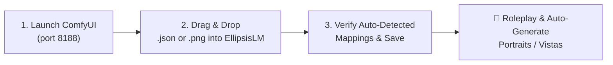
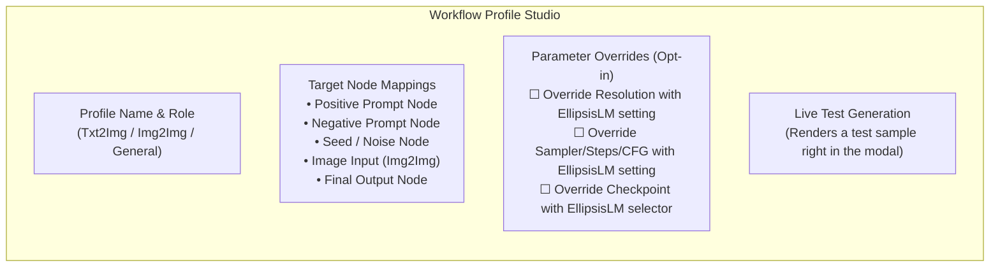

# ComfyUI Integration & Custom Workflow Studio Guide

EllipsisLM features a **native, zero-friction ComfyUI connection** that allows you to bring your own custom workflows (SDXL, SD1.5, Flux, Pony, Illustrious, and custom pipelines) directly into your roleplay sessions.

Unlike conventional tools, **you do NOT need to enable ComfyUI Developer Mode** or manually export special API JSONs. EllipsisLM accepts standard ComfyUI `.json` saves as well as ComfyUI-generated `.png` images directly.

---

## ⚡ Quick Start: Up & Running in 3 Steps



1. **Launch ComfyUI**: Make sure your ComfyUI server is running (default: `http://127.0.0.1:8188`).
2. **Open Settings**: In EllipsisLM, open **Settings** (`⚙️`) &rarr; **Image Generation** &rarr; select **ComfyUI (Local)**.
3. **Drop Your Workflow**: Drag and drop any ComfyUI `.json` workflow or an image `.png` you generated in ComfyUI into the **Custom Workflow Profiles** dropzone.
4. **Review & Save**: EllipsisLM will automatically detect prompt nodes, seed nodes, and output images. Click **Save Profile**.

---

## 🧩 Supported Workflow Formats

You can import workflows using either of the following formats:

| Format | Source | Description |
| :--- | :--- | :--- |
| **ComfyUI Generated `.png`** | File output from ComfyUI | **Recommended & easiest.** ComfyUI embeds the complete workflow graph directly inside the PNG's metadata (`tEXt` chunks). Simply drag a picture you previously rendered into EllipsisLM! |
| **Standard `.json` Save** | ComfyUI menu &rarr; `Save` | Standard LiteGraph UI save. EllipsisLM contains a built-in compiler that translates UI links, widgets, inlines Primitive nodes, and walks Reroutes into an executable API graph automatically. |
| **API Format `.json`** | ComfyUI Dev Mode &rarr; `Save (API format)` | Pre-flattened API dictionary format. Also fully supported if you already have API files. |

> [!TIP]
> You never need to dig through ComfyUI's menu to find API exports. Simply saving an image from ComfyUI and dropping that image file into EllipsisLM will extract the exact workflow that generated it!

---

## 🎯 How EllipsisLM Maps Your Story into ComfyUI

When your roleplay narrative requests an image (e.g. character portrait, mood visual, or world map location vista), EllipsisLM needs to know where to insert the prompt, seed, and optional source image.

EllipsisLM supports two complementary methods:

### Method 1: Placeholder Tags (`{{prompt}}`)
If you want granular control over styling keywords in your ComfyUI workflow, you can add `{{prompt}}` or `{{negative_prompt}}` directly into any text input node in ComfyUI before exporting:

```text
masterpiece, cinematic lighting, 8k, detailed anime style, {{prompt}}, vibrant volumetric light
```

When generating an image, EllipsisLM preserves your surrounding tags and replaces only `{{prompt}}` with the live story context!

### Method 2: Smart Link Auto-Detection (Zero Manual Tagging)
Don't want to edit your workflow at all? No problem. When you import any standard workflow:
- EllipsisLM traces conditioning links upstream from `KSampler` (or Flux `BasicGuider` / `FluxGuidance`) to find your positive and negative `CLIPTextEncode` nodes.
- Identifies seed controls on `KSampler` or `RandomNoise`.
- Identifies image inputs on `LoadImage` for Image-to-Image tasks.
- Locates the final `SaveImage` node to display the result.

---

## 🎛️ The Workflow Profile Studio

When you import or edit a workflow, the **ComfyUI Workflow Profile Studio** modal lets you inspect and fine-tune every parameter:



### Understanding Parameter Overrides
By default, **all overrides are disabled (unchecked)**:
- **Resolution**: Kept identical to the width/height defined inside your workflow (great for native Flux or SDXL resolutions). If checked, EllipsisLM's aspect ratio preset overrides it.
- **Sampler & Steps**: Kept identical to the sampler, scheduler, and steps configured in your workflow (e.g., 4 steps for Flux Schnell, 8 steps for Turbo, or 30 steps for DPM++).
- **Checkpoint**: Kept to the model checkpoint embedded in your workflow. If checked, EllipsisLM's dropdown selector will swap the model on the fly.

---

## 🎭 Multi-Profile Management (Txt2Img vs Img2Img)

You can save multiple workflow profiles and assign them to distinct roles:

- **Text-to-Image (`Txt2Img`)**: Used when generating brand-new character portraits, scenic vistas, and visual master narrative illustrations.
- **Image-to-Image (`Img2Img`)**: Used when evolving an existing character portrait, modifying emotions, or painting over background art.
- **General (`Both`)**: Can serve as either depending on whether an initial image is present.

Use the dropdowns at the top of the ComfyUI settings panel to choose which profile is active for each mode.

---

## 🛠️ Diagnostics & Troubleshooting

### Server Status Shows "Offline ❌"
1. Verify ComfyUI is running in your terminal or background service.
2. Confirm the URL is correct (default: `http://127.0.0.1:8188`).
3. Click the **Auto-Detect** button to let EllipsisLM test standard local ports.

### Custom Nodes Not Recognized
If your workflow uses community custom nodes (e.g. ControlNet preprocessors, third-party samplers):
- Make sure those custom nodes are installed in your ComfyUI `custom_nodes/` directory.
- When ComfyUI is online, EllipsisLM queries `/object_info` dynamically to understand any custom node schemas.

### Testing Without Narrative Clutter
Before diving into a roleplay story, click **Run Test Generation** inside the Workflow Profile Studio. A sample image will generate and render immediately inside the editor to verify that all links and outputs are functioning properly.
